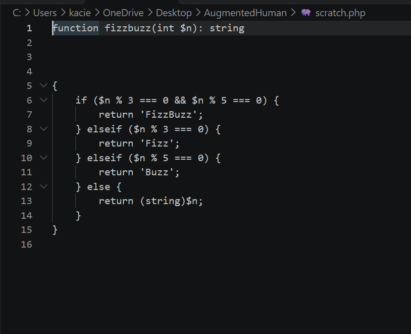

# Lab 0 submission

## Copilot suggestion screenshot

## What the app does

LinkKeeper is a small Laravel 13 bookmark manager. Each bookmark has a title, a URL, an optional visited_at and a pinned flag. It's a starter app for an AI-augmented development course, with no JS build, and it uses SQLite with 30 seeded bookmarks.

routes/web.php redirects / to /bookmarks. It also defines the bookmark list, create and toggle-pin routes, plus a JSON /health endpoint.
BookmarkController.php has index, store (with validation) and togglePin. It has a "probably broken?" TODO on store. The index ordering also doesn't match its comment ("pinned first, newest-first").
Bookmark.php and Tag.php are the models. index.blade.php is the view.
TagNormalizer.php is deliberately unimplemented. Every method throws, because it's the subject of a TDD lab on normalizing and merging messy tags. The cases are in docs/merge-cases.md.

## Oddity found

The tags:merge --dry-run command doesn't exist yet. routes/console.php contains only "No scheduled commands yet." docblock reads it as if it already exists.
